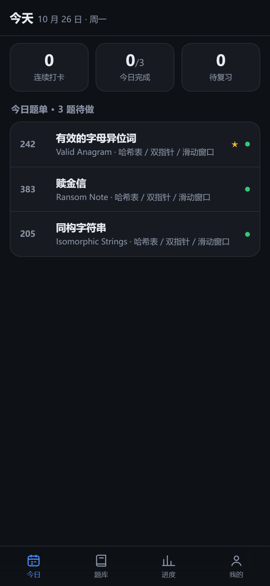
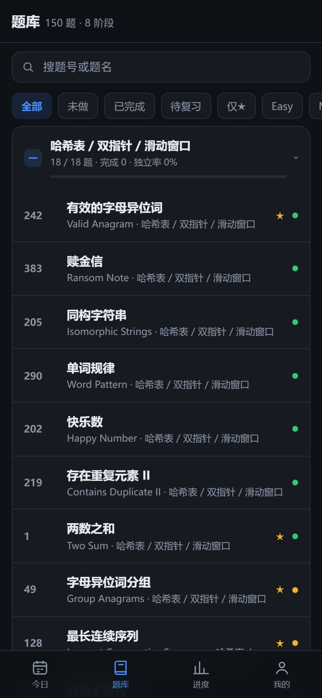
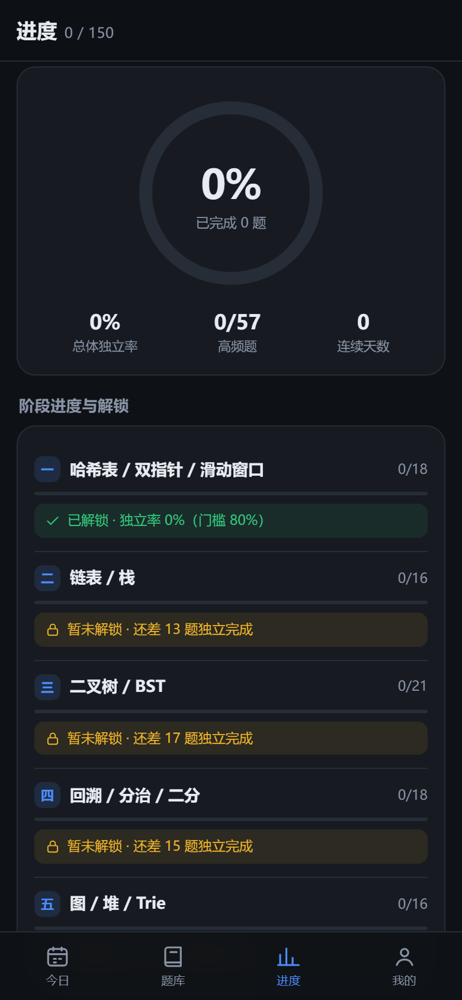

# LeetCode 150 刷题打卡 · Android 版

[](LICENSE)

一个**纯本地**的 LeetCode Top Interview 150 刷题与复习管理工具：150 题按 8 个阶段重排，
「今日」自动出 3 题、完成时做「三档自评」并按 D+1/D+3/D+7 自动排复习、阶段独立率 ≥80% 才解锁下一阶段。
Android 原生壳 + WebView 前端，**零联网、零权限**（仅震动），APK 约 80 KB。

**直接使用**：到 [Releases](../../releases) 下载最新 `lc150-tracker.apk`，安装即用（Android 7.0+），
点「打开题目」会跳到系统浏览器里的 leetcode.cn 题目页。

| 今日 | 题库 | 进度 |
| --- | --- | --- |
|  |  |  |

> `utils/` 与 `data/` 是业务逻辑的唯一来源（WebView 前端与微信小程序版共用），
> APK 构建时由 `tools/bundle.js` 打包成 `bundle.js`。

---

## 一、安装

**安装包：从 [Releases](../../releases) 下载 `lc150-tracker.apk`**（约 80 KB，自签名，未上架应用商店）

1. 把 APK 传到手机（数据线 / 微信文件传输助手 / 网盘都行）
2. 点击安装，系统提示「未知来源」时允许（这是自签名包，没有上架应用商店）
3. 打开即用，首次是空数据

要求：Android 7.0（minSdk 24）及以上。

安装后点底部四个 tab 切换「今日 / 题库 / 进度 / 我的」，进题库点任意一题进详情，
详情页的「打开题目」会拉起系统浏览器。飞行模式下六个页面全部可用。

**升级**：下载新版 APK 直接覆盖安装即可，数据不会丢（同一个签名密钥）。
**卸载**：`localStorage` 会随卸载清除，重要记录先在「我的 → 导出数据 → 保存为文件」备份。

---

## 二、目录结构

```
LeetCode150-Android/
├── README.md                      本文件
├── lc150-tracker.apk              安装包（直接装这个）
│
├── app-droid/                     Android 工程
│   ├── AndroidManifest.xml        清单（仅 VIBRATE 权限，无 INTERNET）
│   ├── build.sh                   一键构建（不依赖 Gradle）
│   ├── README.md                  ★ 详细技术说明：实现、测试、版本记录、已知限制
│   ├── java/com/lc150/tracker/
│   │   └── MainActivity.java      WebView 壳 + 浏览器跳转 + 剪贴板 + 文件选择 + 返回键
│   ├── res/                       图标、应用名、主题（含关闭系统强制深色）
│   ├── assets/www/                前端
│   │   ├── index.html
│   │   ├── css/app.css
│   │   └── js/
│   │       ├── env.js             wx 存储 API 适配层 + 原生桥
│   │       ├── bundle.js          构建产物（勿手改，由 tools/bundle.js 生成）
│   │       └── ui.js              6 个页面与路由
│   ├── tools/                     bundle / 断言 / 截图 / 点击回归 / 图标 / 打包
│   ├── keystore/lc150.jks         签名密钥（务必保留，换了签名只能卸载重装；不入库）
│   ├── build/shots/               界面截图（6 屏 + tab 切换 + 备份链路，390×844）
│   └── out/lc150-tracker.apk      构建产物
│
├── utils/                         ★ 共享业务逻辑源码（构建时打包进 APK）
│   ├── store.js                   唯一读写出口：进度/设置/题单/排期/导入导出/快照
│   ├── bank.js                    题库只读访问层
│   └── date.js                    日期工具
├── data/
│   └── questions.js               150 题数据（由 leetcode150.json 生成，勿手改）
└── tests/
    ├── verify-store.js            84 项逻辑断言
    └── verify-backup.js           40 项备份/恢复断言
```

`utils/`、`data/`、`tests/` 与微信小程序版同源，APK 构建时
`tools/bundle.js` 会从 `../utils` 和 `../data` 读取并打包。改了小程序侧的逻辑后，
把对应文件复制回本目录即可。

---

## 三、自己构建

环境：Android SDK（build-tools 36.0.0 + platforms android-34）、JDK、Node、Python，
不需要 Gradle / Android Studio。

```bash
cd app-droid
bash build.sh
```

工具路径按这个优先级找：环境变量 `ANDROID_SDK_ROOT` / `NODE_BIN` / `PYTHON_BIN`
→ 本地文件 `app-droid/build.env`（已 gitignore，适合固定本机版本）→ `PATH` / 常见安装位置。

产物写到 `app-droid/out/lc150-tracker.apk`，同时把新包复制一份到本目录根下。

构建链路：`bundle.js` 打包业务逻辑 → 拷到无中文的临时目录（aapt2 不支持中文绝对路径）
→ `aapt2 compile/link` 编译资源与 assets → `javac --release 8` 编译 MainActivity
→ `d8` 转 dex → `tools/pack.py` 把 dex 塞进 apk → `zipalign` + `apksigner` 签名。

> 签名口令不在仓库里：`build.sh` 读环境变量 `LC150_KS_PASS` 或本地 `app-droid/keystore/keystore.properties`
> （`storePassword=` / `keyPassword=`）。`keystore/` 目录已被 `.gitignore` 排除。
> 若 `keystore/lc150.jks` 丢失，`build.sh` 会在有口令的前提下生成一份新密钥，但**新签名的包无法覆盖
> 安装旧版**，需要先卸载。想保住升级链路，就把密钥文件和口令一起备份到私密位置。

### 自测（共 239 项断言，全部应通过）

```bash
# H5 业务逻辑（36 项，模拟浏览器环境跑真实 bundle）
cd app-droid && node tools/check.js

# 共享逻辑（84 项，与小程序侧同源）
node tests/verify-store.js

# 备份 / 恢复专项（40 项：导出完整性、校验一致性、快照撤销、跨设备往返）
node tests/verify-backup.js

# 真实点击回归（17 项 tab 切换 + 44 项备份链路 + 18 项每日目标，需要先起本地服务）
cd app-droid/assets/www && python -m http.server 8765
cd app-droid && node tools/clicktest.js && node tools/clicktest-backup.js && node tools/clicktest-target.js
```

---

## 四、功能一览

- 150 题按学习曲线分 8 个阶段，数据与 `leetcode150.json` 逐字段一致
- 每日按 `order` 自动出题（当天冻结，不会刷一次变一次），配合连续打卡
- 25 分钟计时（Hard 40 分钟上限），超时不打断
- 三档自评决定复习间隔：
  - 独立做出 → D+7
  - 看提示做出 → D+3、D+7
  - 看了题解 → D+1、D+3、D+7
- 阶段门禁：该阶段独立完成率 ≥ 80% 才提示可以进入下一阶段（只提示，不硬拦）
- 题库 8 阶段折叠 + 难度/状态筛选 + 题号标题搜索
- 进度页：总进度环、各阶段独立率、连续天数、难度分布
- 深/浅主题、考试模式、每日目标（1~10 题）
- 换机迁移：「我的 → 导出数据 → 保存为文件」，新机器「选择文件导入」；
  导入前自动留快照，导错了能一键撤销

---

## 五、版本

| 版本 | versionCode | 内容 |
| --- | --- | --- |
| v1.2.1 | 5 | 修复每日目标 3→5→3 后题单停在 5 题（补上题单收缩分支，已完成题优先保留） |
| v1.2.0 | 4 | 换机迁移改为文件级（SAF 保存 / 选择文件），导入前快照 + 撤销，备份专项测试 84 项 |
| v1.0.1 | 2 | 修复真机底部 tab 点不开；加运行期错误兜底条 |
| v1.0.0 | 1 | 首个可安装版本 |

完整的实现细节、踩坑记录与已知限制见 [`app-droid/README.md`](./app-droid/README.md)。

---

## 六、说明

个人自用工具，与 LeetCode 官方无关。应用不抓取题干，只存题号、标题、难度、标签和链接；
看题与提交都在浏览器里的 leetcode.cn 完成，本应用只负责记录与排期。

> 本项目为个人刷题工具，与 LeetCode 官方无任何关联，也未获得其授权或背书。
> 项目仅收录题目名称与官方链接用于索引，题目内容版权归 LeetCode 所有，请前往官方站点查看题目。
